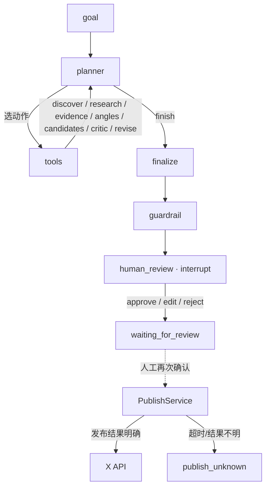

# X AI Content Agent

从「一个话题或目标」到「一条可发布的中文 X 帖子」的 Agent 流水线，外加一个人工审核控制台。

Agent 自己检索材料、提炼证据、形成观点、写出候选正文、自我评审，在交付前**停下来等人决定**；
发到 X 永远需要人再确认一次。整个仓库的重心不在「让模型生成一段文字」，而在
**可追溯的证据、可判定的预算、确定性的质量门禁、以及一套绝不自动发布的发布边界**。

> 这是一个**个人项目**，不是一个在线服务：仓库里没有在线 Demo、没有部署地址、
> 没有用户量或效果数据。下面的所有数字都来自本机实际跑出来的结果（见 [§8](#8-测试与评估)），
> 没有凭据时只能运行「测试 / 评估」这两块，完整跑一条真实链路需要自备 LLM 与 X 凭据。

---

## 目录

- [1. 这个项目解决什么问题](#1-这个项目解决什么问题)
- [2. 技术栈](#2-技术栈)
- [3. 架构与 Agent 工作流](#3-架构与-agent-工作流)
- [4. 内容生成链路的关键环节](#4-内容生成链路的关键环节)
- [5. 发布安全边界](#5-发布安全边界)
- [6. 本地安装与启动（Windows 实测）](#6-本地安装与启动windows-实测)
- [7. 环境变量](#7-环境变量)
- [8. 测试与评估](#8-测试与评估)
- [9. 当前限制与未完成项](#9-当前限制与未完成项)
- [10. 文档索引](#10-文档索引)

---

## 1. 这个项目解决什么问题

「用 LLM 发帖子」的难点不是生成，而是**生成的每一步都不可信**：材料可能是编的、
预算可能被模型无视、模型可能自己把帖子发出去。这个项目把这些问题拆成可验证的工程约束：

| 问题 | 这里的做法 |
| --- | --- |
| 模型说了算？ | 步数 / 检索次数 / 候选数 / 改稿次数在 `config/agent.yaml` 配置，由 `app/agent/budget.py` **用纯 Python 强制**，不依赖模型自觉 |
| 观点没有依据？ | 证据抽取这一环要求每条证据可追溯到具体来源；评估里 `RULE-006` 是硬门禁 |
| 自我评审形同虚设？ | Critic 给 `accept / revise / reject`；改稿会作废旧评价，必须重新评审（`RULE-005` 硬门禁） |
| 模型自己发文？ | 链路跑到 `finish` 就停在 `waiting_for_review`；发布是**另一件**、需要人再次确认的事 |
| 发出去结果不明怎么办？ | `publish_unknown` 是一等状态，交给人裁决，系统既不重发也不算失败 |

## 2. 技术栈

后端（本机实测版本）：

| 组件 | 版本 | 用途 |
| --- | --- | --- |
| Python | 3.12 | 运行环境 |
| FastAPI | 0.141.1 | HTTP API（`/api/*`、`/api/admin/*`） |
| Uvicorn | 0.54.0 | ASGI server |
| LangGraph | 1.2.12 | Agent 编排（`StateGraph` + interrupt） |
| langgraph-checkpoint | 4.2.0 | Postgres checkpointer（断点/恢复） |
| SQLAlchemy | 2.1.1 | ORM（async） |
| psycopg | 3.3.6 | Postgres 驱动（异步） |
| Alembic | 1.20.0 | 数据库迁移 |
| Pydantic | 2.13.5 | 请求/响应与结构化输出校验 |
| httpx | 0.28.1 | X API 与 LLM 调用 |
| openai | 3.19.2 | OpenAI 兼容客户端（可指向任意兼容服务） |
| PostgreSQL | 16 | 主库 + checkpointer 库 |

前端：

| 组件 | 版本 |
| --- | --- |
| React | 18.3.1 |
| TypeScript | 5.6.2 |
| Vite | 5.4.8 |
| react-router-dom | 6.26.2 |
| recharts | 2.12.7 |

## 3. 架构与 Agent 工作流

### 3.1 两条链路并存

- **话题链路（V1）**：调用方给定 `topic`，Agent 直接围绕它工作。
  拓扑 `research → generate → guardrail → human_review`。
- **Agent 链路（Phase 5A 起）**：调用方只给 `goal`，选题由 Agent 自己发现。
  拓扑 `planner ⇄ tools → finalize → guardrail → human_review`，最多 12 步。

两条拓扑在同一个 `StateGraph` 里，用 `state["goal"] is None` 区分。`thread_id` 就是
`agent_run.id`，完整状态（含每步决策）存在 Postgres 里，可以中断、可以恢复。
在 Agent 选定之前 `topic` 是 `NULL`——这是正常运行状态，不是脏数据。

### 3.2 主流程（Agent 链路）



纯文本版：

```
话题 / 目标
   ↓
planner ── 决定下一步动作（有预算约束）
   ↓  ⇅
tools:  discover_topics → research_topic → deepen_research → extract_evidence
        → generate_angles → select_angle → generate_candidates → criticize → revise
   ↓
finalize        选定最终候选（超长一律不进交付）
   ↓
guardrail       规则检查（提示性 + 门禁）
   ↓
human_review    中断在此，等人
   ↓
（人批准/编辑后）PublishService 再次确认 → 发到 X
```

### 3.3 目录结构

```
app/
  agent/            Agent 决策与执行
    budget.py         预算与「下一步能不能做」的确定性判定
    graph.py          LangGraph 编排
    post_structure.py 写作契约：候选角色、证据形态、交付长度
    relevance.py      目标相关性门禁
    context.py        读侧上下文
    query_broadening.py 检索式扩展
    nodes/            planner / research / generate / guardrail / human_review / finalize
    tools/            discover, research, evidence, angles, candidates, critic, revise
    metrics.py        运行质量指标（被 evals 复用）
  api/              业务 API 与只读运营控制台 API（/api/admin/*）
  services/         LLM、X API、发布、自动审核、自动发布、OAuth
  db/               SQLAlchemy 会话 + LangGraph checkpointer
  models/           数据模型
  repositories.py   数据访问（含 analytics 聚合）
  logging_setup.py  落盘日志（RotatingFileHandler）
  main.py           FastAPI 应用
frontend/           React + Vite 运营控制台
  src/pages/        Overview / Runs / Review / Published / Analytics
evals/              Agent 评估实验室（离线、不调真实 X / LLM）
docs/               设计、handoff、评估说明
tests/              后端测试
config/             agent.yaml（预算）、persona.yaml（人格与交付长度）、automation.yaml（自动发布开关）
prompts/            Agent 与写作 prompt
alembic/            数据库迁移
```

> `evals/` 与 `app/` 共用生产实现（如 `app/agent/budget.py`、`app/agent/metrics.py`），
> 不复制第二套逻辑——评估的对象必须是**生产那份**判定。

## 4. 内容生成链路的关键环节

- **证据检索**：检索最近窗口内的真实 X 帖子（只读 `search` 端点），按多作者聚类，
  由 `app/agent/trends.py` **用纯 Python 打分**，判定 `qualified / weak_support / stale / low_signal`。
  分数是**项目内部的排序信号**，不是 X 官方热度排名。
- **选题**：`discover_topics` 产出候选；Agent 链路里这一步由 Agent 自己发起。
- **证据抽取**：`extract_evidence` 把材料压成可追溯的证据条目，后续观点必须挂在证据上。
- **观点生成**：`generate_angles → select_angle`，先出多个角度，再选定一个。
- **三个候选正文**：`generate_candidates` 按固定角色出三条——
  `鲜明观点型 / 事实与反差型 / 讨论与不同视角型`（`ROLE_ORDER`）。
- **Critic**：`criticize` 对候选给 `accept / revise / reject` 与分数、flags、改写目标。
  其中**超过交付硬上限的 `accept` 会被确定性改判为 `revise`**（只动决策，不动分数与正文）。
- **改写**：`revise` 按评审意见改稿；改完会**作废该候选的旧评价**，`finish` 因此被挡住，
  直到新一版被重新评审过。
- **人工审核**：`human_review` 是一处 LangGraph `interrupt`。人在控制台里
  **批准 / 编辑 / 拒绝**；批准或编辑后，内容**仍然**需要单独确认才会发出去。

### 4.1 交付长度：140 字，是「我们的标准」不是「平台的限制」

正文长度在 `config/persona.yaml` 的 `max_length`（默认 **140**）里配置。
这是**项目自己的交付标准**：这个 X 账号本身是 Premium，发得更长并不会被平台拒收，
所以把它说成「平台限制」是错的。它的边界是**严格大于**才违规（正好 140 合规），
判界统一走一个函数：

```
app/agent/post_structure.over_hard_limit(content, max_length) -> 超出的字数
```

同一个尺子用在**四处**：

1. **Critic**：超长的 `accept` 改判成 `revise`。
2. **finalize**：候选池按超没超长分档；整池都超时抛 `AgentOverlongError`，Run 安全失败、不写草稿。
3. **话题链路（V1）generate**：写草稿**之前**判界，超长直接安全失败——不写草稿、不进人工审核。
   V1 没有候选池也没有改写回路，这里**故意不**为它加一次 LLM 调用或新节点。
4. **发布预检**：超长 → `OUTCOME_INVALID`，在任何 X 调用之前拦下。

它**不截断**正文，也**不**把超长悄悄记成成功：`AgentOverlongError` 继承
`AgentIncompleteError`，走既有的「这次 Run 没有可交付正文」的失败路径。

## 5. 发布安全边界

这几条是有意为之的硬约束，改动它们之前请先读 `docs/` 里的设计文档：

1. **Agent 不会自己发帖。** 跑到 `finish` 就停下，状态进入 `waiting_for_review`。
2. **审核是独立的一步。** 批准或编辑之后，内容**仍然**需要单独确认才会发到 X。
3. **发布对话框要求显式勾选**「我明白这一步会立刻公开发出」，否则确认按钮不可点。
4. **`publish_unknown` 不等于失败。** 请求超时/结果不明时状态是 `publish_unknown`
   （界面写作「发布结果未定」），必须人工裁决，系统不会自行重发或当作失败。
5. **发布状态以 `published_post` 为准**，Run 自己的状态只是它的镜像视图。
   控制台是审计记录，不是 X 的实时镜像——在 X 上删帖不会同步回这里。
6. **改稿必须重新评审。**（见 §4）
7. **自动发布默认关闭，且默认只影子运行。** `config/automation.yaml` 里 `enabled: false`；
   即使打开，`mode: shadow` 也意味着「判断照常跑、照常记录，但什么都不发」。
   转 `live` 需要先用 `GET /api/admin/auto-publish/status` 看是否达到一致性门槛。
   这个文件每个 tick **重新读一次**——改它就是热杀开关。

## 6. 本地安装与启动（Windows 实测）

### 6.1 环境要求

- **Python 3.12**
- **Node.js 20+**（前端）
- **PostgreSQL 16**（Docker 或本机均可）
- Docker（若用 `docker compose` 起库）

### 6.2 安装 Python 依赖

`pyproject.toml` 里的约束全是 `>=`、没有上界，只按它装会拿到「当下最新」而不是
「验证过的这一套」（例如 `langgraph>=0.2` 在 2026-09 解析成了 1.2.12，跨了大版本）。
所以仓库里锁了一份**验证过的依赖快照** `requirements.lock.txt`（67 包）：

```bash
# 建环境（conda 或 venv 二选一）
conda create -n 2026-agent python=3.12 && conda activate 2026-agent
# 或： python -m venv .venv && .venv/Scripts/activate

python -m pip install -r requirements.lock.txt
python -m pip install -e . --no-deps     # 装项目本身，别动已锁的依赖
```

> `requirements.lock.txt` 是 **Windows / CPython 3.12** 的快照，含 `psycopg-binary`
> 等平台特有包；换平台时改按 `pyproject.toml` 安装，别直接套用。

### 6.3 数据库

```bash
docker compose up -d postgres
<PYTHON> -m alembic upgrade head
```

> Docker Hub 不可达时，可先经镜像站拉 `postgres:16-alpine` 再本地 retag。
> 本机把容器映射到 **5433**（5432 被另一个项目占着）——端口在 `.env` 里改，见 §7。

### 6.4 后端

```bash
<PYTHON> run.py
```

监听 `127.0.0.1:8000`（`/health` 健康检查、`/docs` OpenAPI）。

> 不要直接 `uvicorn app.main:app`：uvicorn 0.36+ 在 Windows 上会选用
> `ProactorEventLoop`，而 psycopg 的异步连接在它上面会全部失败。
> `run.py` 已显式指定 `app.loops:selector_loop_factory`，并在启动时把日志开到 `logs/backend.log`。

### 6.5 前端

```bash
cd frontend
npm install
npm run dev
```

监听 `127.0.0.1:5173`，并把 `/api` 代理到后端 8000。
控制台页面：`/`、`/runs`、`/review`、`/published`、`/analytics`。

> 若 `npm install` 退出码是 0 却什么都没装（`node_modules` 里没有 `tsc`），
> 多半是本机 npm 缓存目录不可写；换一个可写的 cache 目录再装。

### 6.6 一条命令拉起全部（可选）

仓库根目录的 `start.bat`（Windows）会按 **PostgreSQL → 后端 → 前端** 的顺序启动，
并在启动前检查端口占用、必要时拉起 Docker Desktop。它假定：
`CONDA_ENV=2026-agent`、miniconda 在默认位置、仓库路径与 conda 路径**都不含空格**。
路径不同时，改 `start.bat` 顶部的五个变量即可（脚本注释里写明了每个变量的用途）。

## 7. 环境变量

复制模板后填写：

```bash
cp .env.example .env
```

| 变量 | 说明 |
| --- | --- |
| `POSTGRES_USER` / `POSTGRES_PASSWORD` / `POSTGRES_DB` / `POSTGRES_PORT` | 数据库账号/库名/端口 |
| `DATABASE_URL` | 应用连接串（`postgresql+psycopg://...`） |
| `LANGGRAPH_CHECKPOINT_DATABASE_URL` | checkpointer 连接串；留空则由 `DATABASE_URL` 推导 |
| `LLM_API_KEY` / `LLM_BASE_URL` / `LLM_MODEL` | OpenAI 兼容接口（`base_url` 可指向任意兼容服务） |
| `X_API_BEARER_TOKEN` | X **只读检索**（`search` 端点，app-only） |
| `X_API_KEY` / `X_API_SECRET` / `X_ACCESS_TOKEN` / `X_ACCESS_TOKEN_SECRET` | **发帖**必须用 OAuth 1.0a user context；Bearer token 发不了帖 |

**两点必须记住：**

- `POSTGRES_PORT` 与 `DATABASE_URL` 里的端口是**两处**，改端口时一起改。
- **`.env` 已在 `.gitignore` 里，永远不要提交真实密钥。** 仓库里只有 `.env.example`，
  其中的值全是占位符。没有对应凭据时：测试与评估照常可跑（它们全程 mock X 与 LLM），
  但真实检索、真实生成、真实发布都无法完成。

## 8. 测试与评估

### 8.1 命令

```bash
# 后端
<PYTHON> -m pytest -q

# 前端
cd frontend
npm run test:frontend      # node --test
npx tsc --noEmit           # 类型检查
npm run build              # 构建

# 评估实验室（离线，不调真实 X / LLM）
<PYTHON> -m evals.selftest                              # 评估器自检
<PYTHON> -m evals.run_benchmark --fixture               # 跑全部 fixture
<PYTHON> -m evals.run_benchmark --dataset goals.json    # 按基准目标判定
```

> **⚠️ 同一时刻只能有一份 pytest 在跑。** 测试库 `xagent_test` 是**跨进程共用**的一个库，
> `tests/conftest.py` 在每个测试前 `TRUNCATE` 全部业务表。两份 suite 并发时互相清表，
> 会出现「失败集合每轮都不一样」的假故障——看到零散且每轮不同的失败，先确认没有另一份 pytest 在跑。

测试全程 mock X API 与 LLM，不消耗真实 credits，也不碰 `xagent` 主库。

### 8.2 最近一次实测结果（2026-10-10，本机）

| 项目 | 结果 |
| --- | --- |
| 后端 `pytest -q` | **1126 passed**（串行，单进程） |
| 前端 `npm run test:frontend` | **251 passed** |
| 前端 `tsc --noEmit` | 通过 |
| `evals.selftest` | **16 passed** |
| `evals.run_benchmark --fixture` | 通过 |
| `evals.run_benchmark --dataset goals.json` | **22** 个基准目标判定完成 |

> 这些是本机跑出来的真实结果，不是承诺。数字随提交变化，以你自己跑到的为准。

### 8.3 评估覆盖什么

- **结构指标**：步数、检索次数、改稿次数、预算是否耗尽……
- **行为规则**（**24 条，其中 20 条硬门禁**）：非法动作的恢复、预算不得被越过、
  改稿后必须重新评审、证据必须可追溯、不得自主发布，以及话题侧的若干条。
  门禁的纪律是「不确定就判失败」——一个悄悄放行的门禁比没有门禁更危险。
- **内容质量**：人工维度**暂不填写**——不拿字符串规则冒充内容评审。

`--live` 被显式拒绝：对真实环境跑评估不可复现。

## 9. 当前限制与未完成项

- **自动发布默认关闭**，且默认处于 `shadow` 模式（只判断、不发布）。这条链路的
  `live` 门槛尚未达到，不能按「已经能无人值守发文」来理解。
- **完整跑一条真实链路需要自备凭据**：一个 OpenAI 兼容的 LLM key，加上 X 的
  Bearer（检索）与 OAuth 1.0a（发帖）四件套。缺任一项，对应环节会失败并如实报错。
- **内容质量的人工评估维度仍是空的**——目前只有结构与行为两类机器可判定的指标。
- **单机开发为主**：并发发布、多租户、限流这些都没做，也不在范围内。
- 控制台是**审计视图**：X 上的删除/改帖不会同步回来。

## 10. 文档索引

- [`docs/setup-new-machine.md`](docs/setup-new-machine.md) —— 换一台机器跑起来的完整步骤
- [`docs/env-handoff.md`](docs/env-handoff.md) —— 环境与依赖细节
- [`docs/phase-5a-agent-brain-design.md`](docs/phase-5a-agent-brain-design.md) —— Agent 决策链路设计
- [`docs/phase-5b1-content-intelligence.md`](docs/phase-5b1-content-intelligence.md) —— 选题与趋势打分
- [`docs/phase-5b2-style-intelligence.md`](docs/phase-5b2-style-intelligence.md) —— 风格层
- [`docs/phase-5b3-viewpoint-intelligence.md`](docs/phase-5b3-viewpoint-intelligence.md) —— 观点层
- [`docs/phase-5c-learning-readiness.md`](docs/phase-5c-learning-readiness.md) —— 学习层（只观察）
- [`docs/phase-auto-publish.md`](docs/phase-auto-publish.md) —— 自动发布的开关与阈值
- [`docs/agent-evaluation/`](docs/agent-evaluation/) —— 评估实验室说明
- [`docs/frontend-product-polish.md`](docs/frontend-product-polish.md) —— 控制台产品化记录
- [`docs/integration-stabilization.md`](docs/integration-stabilization.md) —— 集成与稳定化验收报告
